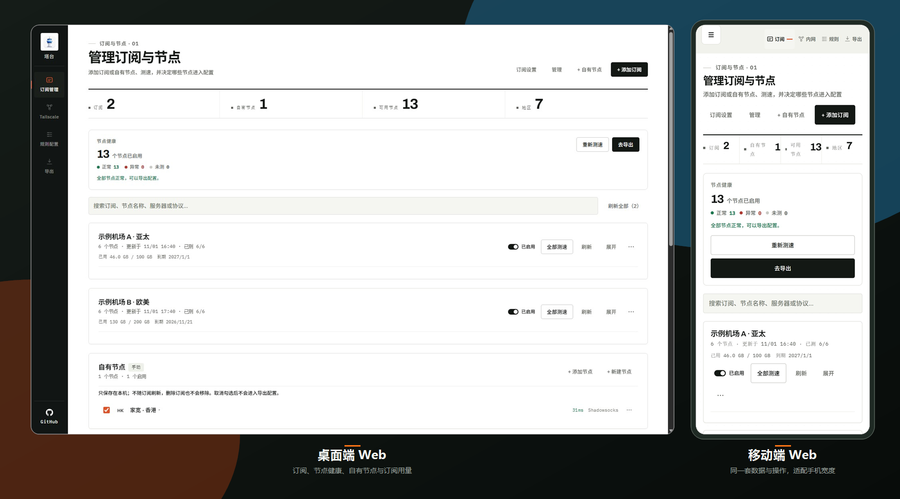

<div align="center">


# 塔台 Tower Web

**订阅管理、节点测速、多客户端配置导出，一处完成。**

本地优先 · 无需账号 · 所有处理都在本机

[](https://github.com/thintsing/tower-web/actions/workflows/ci.yml)
[](https://github.com/thintsing/tower-web/actions/workflows/docker.yml)
[](LICENSE)
[](https://nodejs.org/)
[](https://react.dev/)
[](https://vite.dev/)

[GitHub 仓库](https://github.com/thintsing/tower-web) ·
[快速开始](#快速开始) · [支持的客户端](#支持的客户端) ·
[已知限制](#已知限制) · [常见问题](#常见问题) · [上游与许可](#上游与许可)

</div>

<p align="center">
  
</p>

<p align="center">
  <a href="./docs/screenshot-desktop.jpg">桌面端原图</a> ·
  <a href="./docs/screenshot-mobile.jpg">移动端原图</a>
</p>

> 截图使用虚构订阅、示例节点和虚构用量，不含真实节点、密码或订阅 token。

本项目是 [塔台 Tower（iOS / macOS）](https://github.com/pengchujin/tower) 的 Web 版本，复用其领域模型、订阅解析语义和区域数据。源码与第三方素材的许可范围不同，详见 [第三方声明](THIRD_PARTY_NOTICES.md)。

> 本项目不提供代理服务或节点，只处理用户自己导入的订阅。请遵守所在地法律法规及订阅服务商的使用条款。

## 功能

- **订阅与节点**：支持订阅 URL、Base64、Clash YAML、Surge / Loon / Quantumult X 配置、sing-box endpoint JSON 和单节点 URI；支持批量添加、刷新、停用、节点排除、搜索、订阅公告、已用 / 剩余流量和到期日展示。并发刷新同一订阅时以最后一次为准，同一 URL 共享请求、同一 host 排队，批量刷新会显示完成进度。
- **协议**：Shadowsocks / SSR / VMess / VLESS / Trojan / Hysteria / Hysteria 2 / TUIC / WireGuard / AnyTLS / Snell / SOCKS5 / HTTP / SSH / TrustTunnel / MASQUE；按客户端能力自动跳过无法表达的节点。ShadowTLS、SIP003 `v2ray-plugin`、SS cipher 白名单、Snell / VLESS 版本限制和 Stash 证书 pin 都会按目标客户端校验。
- **自有节点**：可从链接、配置文本、文件导入，也可逐协议手动新建 / 编辑；MASQUE 支持 mihomo 密钥 CONNECT-IP 与 sing-box basic CONNECT-IP 两套方言。节点不随订阅刷新，可单独启用、停用、改名、删除和标记地区。
- **测速与健康**：本机 TCP / ICMP 测速；订阅页汇总正常、异常、未测节点，可重测失败节点，并在节点详情显示来源、地区、ASN 网络组织和 TLS 信息。
- **分布地图**：按四档延迟（≤100 / ≤200 / ≤350 / >350ms）给国家着色；支持按钮 / Ctrl+滚轮缩放、放大后拖动、低倍率地区聚合圆点、地区清单、地图上的全部测速按钮，以及选中地区节点列表内的一键分享。
- **规则方案**：内置 ACL4SSR；支持粘贴、文件或 URL 导入 INI、Clash / mihomo、Surge、Egern 和 sing-box 方案，也可一键导入 Self-Configuration 预设。策略组可新建、删除、改名、按节点名正则建组、改类型、编辑候选、调整匹配顺序；导入来源方案支持全文编辑，复制自内置方案后还可恢复初始规则。条件组（Surge `subnet` / Egern `conditional`）和同方言标量参数会原样写回，其他客户端退回默认策略。
- **策略组展示**：可按组名识别并自动补全 Emoji，规则页可切换显示或隐藏；拖动组改变匹配顺序时，会提示哪些域名从原组改走新组，避免分流被悄悄改变。补充规则按最具体优先排序，规则集插到第一条冲突规则之前，FINAL 不参与拖动。
- **规则集**：内置 ACL4SSR 快照与 871 个在线列表；支持本地 / 在线规则集、刷新、暂停、跨客户端引用或无损展开。开启「优先引用规则集」后，经典列表会自动压成 mihomo / Stash 的 MRS 与 sing-box / Hiddify 的 SRS 二进制规则集，表达不了的类型保持逐条内联；sing-box DNS 投影会额外引用同一列表的 domain-only SRS。
- **固化与屏蔽**：内置 ACL4SSR 方案可「更新并固化」到上游同一 commit 的 INI 与全部列表（任一列表失败整次放弃，原厂快照始终保留）；固化历史保留原厂 + 最近 2 版，可在方案页「回退至此版」，只改本机与同步工作区，不会回滚已导出的客户端配置。固化后的内置方案在规则页显示为「只读」规则集，可按条目「屏蔽 / 解除屏蔽」并「撤销上次屏蔽 / 解除」；被屏蔽条目标记为「已屏蔽 N 条 · 仅编译期生效」，刷新或回退快照后屏蔽仍生效。
- **DNS 与 ECS**：普通 / 国内 / 远程 DNS，跟随方案 / 标准保护 / 严格保护；mihomo 和 sing-box 使用纯节点解析组、DNS 投影与中国子网（ECS）。GEOIP / Surge IP 规则会补 `no-resolve`，仅在 DNS 已走代理时释放末尾 GEOIP 的该选项。
- **导出与分享**：一次生成 7 种载体，按客户端设置完整配置 / 仅节点、地区 / 协议筛选、排序和命名；支持代理集合、Tailscale 内网、二维码和 `clash://` / `surge://` 一键导入。
- **局域网与访问密钥**：可关闭局域网访问；也可生成管理 API 密钥，局域网页面用 `?key=` 打开一次后自动记住。订阅、一次性分享和托管规则集仍是独立凭证。
- **服务器版（可选）**：`TOWER_MODE=server` 时订阅源、节点、规则方案 / 规则集、当前方案选择和 Tailscale（含 Auth Key）保存在服务端 `workspace.json`，任何设备打开都是同一份工作区；服务端离线时只读，多设备并发按版本号检测并提示重新载入。
- **备份**：导出 / 恢复本机 JSON；覆盖恢复前自动保存，本机保留最近 3 份版本；支持一键重置所有本机配置。
- **外观**：跟随系统浅色 / 深色模式，深色模式使用同一套信号轨道设计变量。
- **本地优先（默认）**：默认 `TOWER_MODE=local`，订阅源、解析后的节点、规则方案/规则集和导出偏好只在本机浏览器处理；服务端只保存已发布配置文本和局域网设置；无账号、云同步、遥测或第三方统计。

## 支持的客户端

| 载体 | 客户端 |
| --- | --- |
| Clash / YAML | Clash Verge、Mihomo Party、FlClash、Clash Mi、Clash、ClashMac、Stash、Karing、Shadowrocket |
| Egern YAML | Egern |
| Surge | Surge、Surge Mac |
| Loon / Quantumult X | Loon、Quantumult X |
| sing-box JSON | sing-box、Hiddify |
| Base64 节点订阅 | V2Box、Anywhere |

- sing-box 没有 SSR 出站，SSR 节点不会写入 JSON。
- 发布订阅时，YAML / Surge / Loon / QuanX / Egern 会按各自规则白名单过滤，避免把其他客户端的规则写进去。
- mihomo 的 ECS 需要较新内核并支持 `#代理组` DNS 后缀；sing-box 的 ECS 需要官方 1.14+，Hiddify 1.13 会跳过 ECS 提示。
- Surge 的仅节点输出是纯 `policy-path` 列表；Quantumult X 的仅节点作为 `server_remote` 资源导入；sing-box MT 完整配置提供「规则判定 / 全局代理 / 直接连接」三种模式。
- 经典规则列表会按目标客户端自动转换为二进制规则集：mihomo / Stash 用 MRS（domain + ipcidr 两份引用），sing-box / Hiddify 用 SRS；无法表达的规则类型继续内联。Karing、Shadowrocket 不读 MRS，仍引用经典列表。
- 订阅默认请求没有解析到节点时，会自动用 `clash.meta` 兼容 UA 重试；流量或到期信息缺失时，会按 Clash 方言补探测响应头（最多 6 次、只取响应头不下载正文，命中过的变体会记住）。
- 闭源客户端按规则白名单和引用完整性自检，仍建议在目标客户端实际导入确认。

## 快速开始

要求 Node.js >= 20.19，推荐使用 `.nvmrc` 指定的 Node 22。

```bash
git clone https://github.com/thintsing/tower-web.git
cd tower-web
npm install

# 开发模式：Web 5173 + API 8787
npm run dev

# 生产模式
npm run build
npm start
```

生产模式打开 <http://127.0.0.1:8787>。本项目需要 Node 运行环境，不能只靠静态托管：订阅发布、规则集托管和 TCP / ICMP 测速都依赖 `server/index.mjs`。

### Docker

镜像发布在 GHCR，支持 linux/amd64 与 linux/arm64：

```bash
docker run -d --name tower-web \
  -p 8787:8787 \
  -v tower-data:/app/data \
  ghcr.io/thintsing/tower-web:latest
```

或用仓库内的编排文件：

```bash
docker compose up -d
```

容器默认 `HOST=0.0.0.0`、`PORT=8787`，打开 <http://127.0.0.1:8787>。已发布订阅（生成好的客户端配置文本）保存在数据卷 `/app/data`，重建容器前请保留该卷；也可以用 `TOWER_DATA_DIR` 改路径。默认本地模式（`TOWER_MODE=local`）下，订阅源、解析后的节点、规则方案和规则集仍在浏览器 localStorage，不在这个数据卷里；设置 `TOWER_MODE=server` 后改为保存在 `/app/data/workspace.json`。ICMP 测速依赖镜像内的 `ping`，不可用时自动回退 TCP。

#### 数据目录必须对容器内的 node 可写（bind mount 必读）

容器默认以 `node`（UID 1000）运行。用 `-v /opt/tower/app/data:/app/data` 这类**宿主机目录**时，如果该目录由 root 创建（`sudo mkdir`、Docker 自动创建、或之前用 root 跑过），容器内的 `node` 就写不进去：服务器模式的工作区会一直为空，订阅与设置也存不下来。

镜像会让这种情况变成可见故障，而不是静默的空页面：

- `/api/health` 探测到数据目录不可写时返回 503，容器在 `docker ps` 里显示 `unhealthy`：

  ```bash
  docker inspect -f '{{.State.Health.Status}}' tower-web
  # healthy：进程存活且数据目录可写
  # unhealthy：数据目录不可写（或其它健康检查失败）
  ```

- 页面会显示「服务端数据目录不可写」，并给出修复命令。
- 日志会打印 `[tower] 数据目录不可写…`（服务器模式启动时）或 `[tower] 警告：…数据目录不可写…`（entrypoint 以非 root 启动时）。

修复任选其一：

```bash
# 1) 修正宿主机目录属主（推荐，一次即可）
sudo chown -R 1000:1000 /opt/tower/app/data
docker compose restart tower-web
```

```yaml
# 2) 让容器自己修：以 root 启动，entrypoint 会 chown 后立刻降权到 node 运行服务端
services:
  tower-web:
    user: "root"
```

> `user: "root"` 只影响容器启动的这一步，服务端进程仍是 UID 1000。不想让容器以 root 启动时用第 1 种方式。只读根文件系统（`read_only: true`）下 chown 会失败，entrypoint 只告警并继续启动，健康检查仍会给出 `unhealthy`。

#### 健康检查的含义

`healthy` = **进程存活且数据目录可写**；任一不满足就是 `unhealthy`。`unhealthy` 只是警示，**不会自动重启容器**（`restart: unless-stopped` 只对进程退出生效）。可写探测结果缓存 10 秒：修好权限后最多 10 秒恢复 `healthy`，不需要重启容器。

容器内无法可靠区分「宿主机浏览器」和伪造 `Host: localhost` 的局域网客户端。需要管理密钥时，建议启动时设置 `TOWER_API_TOKEN`。校验规则：本地模式要求 16–128 位 `A-Z/a-z/0-9/_/-`；服务器模式（`TOWER_MODE=server`）放宽为 1–128 个不含空白 / 换行 / 控制字符的字符。**两种模式都建议直接使用 ≥32 位随机值**（例如 `openssl rand -hex 32`），不要用可读短词：

```bash
docker run -d --name tower-web \
  -p 8787:8787 \
  -v tower-data:/app/data \
  -e TOWER_API_TOKEN=replace-with-a-long-random-token \
  ghcr.io/thintsing/tower-web:latest
```

未设置时，宿主机设置页不能创建首个密钥；可以在容器内对回环地址调用 `POST /api/settings/token`，或重启时设置 `TOWER_API_TOKEN`。

Docker 内看到的网卡地址不是宿主机地址；如果从本机打开页面又要复制订阅地址给手机，请把 `TOWER_PUBLIC_URL` 设为宿主机的局域网地址：

```bash
docker run -d --name tower-web \
  -p 8787:8787 \
  -v tower-data:/app/data \
  -e TOWER_PUBLIC_URL=http://192.168.1.10:8787 \
  ghcr.io/thintsing/tower-web:latest
```

推送 `v*.*.*` tag 后，GitHub Actions 会自动构建双架构镜像、推送 GHCR 并创建 Release：

```bash
git tag v0.3.3
git push origin v0.3.3
```

> 镜像默认允许局域网访问，可以在「订阅设置 → 局域网与访问密钥」关闭共享或生成 API 密钥；Docker 下生成首个密钥建议用 `TOWER_API_TOKEN`。`-p 8787:8787` 会把端口暴露到局域网，只建议在可信网络使用。

需要从外部访问、又不想把 8787 直接暴露给局域网或公网时，推荐把端口只绑到回环地址：

```bash
docker run -d --name tower-web \
  -p 127.0.0.1:8787:8787 \
  -v tower-data:/app/data \
  ghcr.io/thintsing/tower-web:latest
```

compose 里对应写 `ports: ["127.0.0.1:8787:8787"]`。仓库内的 `docker-compose.yml` 默认仍是 `"8787:8787"`（方便局域网直连），这里只是建议，不改默认值。如果这台机器上已有 cloudflared、frp 或 nginx 之类的隧道 / 反向代理，把上游指向 `127.0.0.1:8787` 就已经足够，不需要再向局域网开放端口。

> 隧道以 `127.0.0.1` 为源站时，服务端看到的源地址是回环，`/api/settings` 这类「仅本机可改」的接口会按本机放行（会返回包含管理密钥的 JSON）。因此隧道 / 公网场景必须叠加 Cloudflare Access 之类的访问控制，或让隧道侧注入 `x-tower-key`，不要只靠端口绑定。

### 局域网 / 手机访问

服务端默认监听 `0.0.0.0`，导出页会显示局域网订阅地址。设置页「订阅设置 → 局域网与访问密钥」提供两项控制：

- **允许局域网共享**：关闭后，非本机设备无法打开塔台页面、更新订阅或下载规则集；本机 `127.0.0.1` 不受影响。这个开关只控制服务端访问，本身不会把浏览器里的订阅源、节点或规则工作区同步给其他设备；需要跨设备共用工作区请开启「服务器版」。
- **管理 API 访问密钥**：生成后，局域网设备调用抓取、测速、发布订阅和网络信息等 API 时必须带密钥。在手机打开设置页复制的 `http://…:8787/?key=…`，页面会保存密钥并自动附带；默认本地模式下本机访问仍不需要密钥（服务器模式所有设备都要密钥，见下节）。订阅链接、一次性分享链接和托管规则集本身是独立凭证，不要求管理密钥。

只允许本机访问时：

```bash
HOST=127.0.0.1 npm start

# Windows PowerShell
$env:HOST='127.0.0.1'; npm start
```

> 共享开关和访问密钥用于降低误暴露与随手访问风险，不是公网级身份认证。`/api/fetch` 仍可代理 http(s) 地址，`/api/probe` 仍可探测主机端口；请只在可信网络使用，不要直接暴露到公网。公网部署需要反向代理、身份验证、限流和日志脱敏，详见 [SECURITY.md](SECURITY.md)。

### 服务器版（多设备共用一份工作区）

默认 `TOWER_MODE=local`，工作区在浏览器 localStorage，行为不变。需要多台设备共用同一份订阅源、节点、规则方案 / 规则集和当前选择时，用服务器模式启动：

```bash
TOWER_MODE=server TOWER_API_TOKEN='your-shared-key' npm start

# Windows PowerShell
$env:TOWER_MODE='server'; $env:TOWER_API_TOKEN='your-shared-key'; npm start

# Docker
docker run -d --name tower-web -p 8787:8787 -v tower-data:/app/data \
  -e TOWER_MODE=server -e TOWER_API_TOKEN='your-shared-key' \
  ghcr.io/thintsing/tower-web:latest
```

- 工作区保存在 `TOWER_DATA_DIR/workspace.json`（默认 `server/workspace.json`，Docker 下 `/app/data/workspace.json`），结构为 `{ version, updatedAt, data }`。服务端已有数据时不要在运行中手工编辑这个文件。
- 服务器模式下 `/api/workspace` 的所有请求都必须带访问密钥，`127.0.0.1` 也不例外；密钥来源沿用现有机制（`?key=`、`x-tower-key`、`Authorization: Bearer`、`tower_key` cookie）。
- 服务器模式密钥放宽为 1–128 个不含空白 / 换行 / 控制字符的字符，首尾空白会 trim；本地模式仍要求 16–128 位 `A-Z/a-z/0-9/_/-`。服务端不强制长度，**请直接用 ≥32 位随机值**（`openssl rand -hex 32`）；短密钥能被穷举，隧道 / 公网场景还应叠加 Cloudflare Access 之类的访问控制。
- 每台设备首次访问要授权一次：用带 `?key=<密钥>` 的地址打开，或在全屏「需要访问密钥」页里粘贴密钥。密钥存进**该浏览器**的 localStorage `tower-web-api-key`，不跨设备、不跨浏览器 profile；换域名、端口或 http/https 都算另一个来源，需要重新带一次 `?key=`。
- 同一 IP 连续 10 次认证失败，服务端冷却 60 秒；认证成功会清零计数。注意 `/api/auth-status` 本身**不受冷却限制**（页面无密钥时也要能判断模式），带错误密钥时它会记录一次失败但仍正常响应——所以它可以被用来连续试探密钥，别把它当成防穷举的屏障。
- 首次使用：服务端还没有 `workspace.json` 时，打开页面的客户端会把本机现有工作区上传创建，并提示「已上传本机工作区」。服务端已有数据后客户端只读取；要覆盖必须按当前版本号正常写入（例如覆盖恢复），不能静默清空。
- 同步：页面可见时每 8 秒探测一次版本，窗口 `focus` / 标签页切换立即探测；本地改动 500ms 防抖后推送，内容没变不发送。
- 并发写：版本不匹配返回 409，客户端提示「另一台设备刚改过」，随后自动拉取并替换为最新版本，不做自动合并。
- 服务端离线、密钥错误或 `workspace.json` 损坏时页面进入只读，横幅提示「仅本地缓存，改动不会保存」；恢复连接后自动重连。
- 每次写入前服务端保留上一版 `workspace.json.bak`；启动时主文件解析失败会改名为 `workspace.json.broken-<时间戳>`，优先用可解析的 `.bak` 恢复（版本可能回退一版，客户端轮询会自己拉到最新）；`.bak` 也不可用时才返回明确的 `workspace_corrupt`，不会当成空工作区。
- 设备偏好（导出目标、隐藏客户端、排序、Emoji、测速模式、地图状态、高级区展开等）仍留在本机 localStorage，不跨设备同步；Tailscale Auth Key 属于工作区，会保存在服务端。
- 同一个 `TOWER_DATA_DIR` 只支持一个服务进程。两个进程同时写会各自按内存里的版本号覆盖同一个 `workspace.json`，实测会静默丢失更新；需要多副本时请为每个实例使用独立数据目录。

## 数据存在哪里（服务端 vs 浏览器）

| 数据 | 存在位置 | 说明 |
| --- | --- | --- |
| 订阅源、解析后的节点、规则方案、规则集、当前方案/策略选择、导出配置名、Tailscale（含 Auth Key） | 本地模式：浏览器 localStorage `tower-web-state`；服务器模式：`workspace.json` | 本地模式每台电脑、每个浏览器 profile 独立；服务器模式所有设备共用同一份 |
| 设备偏好（导出目标、隐藏客户端、排序、Emoji、测速模式、地图状态、高级区展开等） | 浏览器 localStorage `tower-web-state` | 始终按设备保存，服务器模式也不会同步 |
| 已发布订阅 | `server/subscriptions.json`（Docker 下 `/app/data/subscriptions.json`） | 只保存已生成好的客户端配置文本，按 token 索引；可能包含节点地址、密码、UUID、token 等凭据，但**不是订阅源/节点工作区** |
| 服务端设置 | `server/settings.json`（Docker 下 `/app/data/settings.json`） | 只保存局域网共享开关 `lanSharing` 和管理 API 密钥 `apiToken` |
| 管理 API 密钥 / 登录会话 | 原浏览器 localStorage `tower-web-api-key`；服务端下发的 HttpOnly `tower_key` cookie | 每浏览器独立；按可信设备/成员分发，轮换后旧密钥和会话失效 |
| 已发布 token / 订阅地址 | 原浏览器 localStorage `tower-sub-token` / `tower-sub-url` | 服务端按 token 保存生成产物，但没有订阅列表 API；其他电脑需手动复制已发布地址，或重新发布 |

- **本地模式换电脑**：之前添加的订阅源、解析后的节点、规则方案和规则集不会自动出现，需要重新添加订阅，或通过备份导出/导入迁移浏览器工作区。
- **服务器模式换设备**：打开同一个服务端地址（带 `?key=` 授权一次）即可看到同一份工作区；首次连接时若服务端还没有 `workspace.json`，会把本机现有工作区上传创建。
- **局域网共享开关只控制访问，不共享工作区**：开启时其他设备可以访问服务端页面和 API，默认本地模式下它们各自仍使用自己的 localStorage；关闭时非本机设备不能访问，服务端已发布的内容仍然存在，只是不可达。服务器模式下的工作区由密钥和版本号保护，与这个开关相互独立。
- **服务器模式是单用户模型**：没有角色、多人合并或资源级权限；多设备同时编辑时后写入者收到 409，客户端会提示并载入最新版本，不保留旧编辑。

## 数据与隐私

- 默认本地模式：订阅源、解析后的节点、规则方案/规则集、当前方案选择和导出偏好保存在浏览器 localStorage（`tower-web-state`）；每台电脑或每个浏览器 profile 独立。服务器模式：这些工作区数据（含 Tailscale Auth Key）改为保存在 `TOWER_DATA_DIR/workspace.json`，同样包含节点凭据，按敏感文件保护。
- 已发布订阅（生成好的客户端配置文本）保存在 `server/subscriptions.json`，局域网设置与访问密钥保存在 `server/settings.json`（Docker 下为 `/app/data/`，可用 `TOWER_DATA_DIR` 改路径），均已加入 `.gitignore`；**不要提交包含真实机场节点、密码或 token 的文件**。
- 测速由本机 TCP / ICMP 完成；IP 国家 / ASN 查询使用随包离线数据库；二维码的生成、识别和相机画面都不离开本机。
- Tailscale Auth Key 在本地模式单独保存在本机 localStorage，不进入备份；服务器模式随工作区保存在服务端并存进首页快照。下载或发布配置时会写入支持的客户端。

## 常用命令

| 命令 | 说明 |
| --- | --- |
| `npm run dev` | 同时启动 Vite 与本地 API |
| `npm run build` | TypeScript 检查 + 生产构建 |
| `npm start` | 生产模式运行 `server/index.mjs` |
| `npm run selfcheck:clients` | 校验各客户端配置结构 |
| `npm run selfcheck:dns` | 校验 DNS 投影、纯节点组与 ECS |
| `npm run selfcheck:importers` | 校验规则方案导入 |
| `npm run selfcheck:protocols` | 校验协议解析与降级 |
| `npm run selfcheck:workspace` | 校验服务器版工作区接口、版本号、密钥与并发写 |

<details>
<summary>全部 24 项自检</summary>

```text
selfcheck:asn         离线 IP / ASN 查询
selfcheck:auth        局域网共享 / API 访问密钥 / 并发落盘
selfcheck:backup      备份与版本历史
selfcheck:batch       批量订阅导入
selfcheck:catalog     在线规则目录
selfcheck:clients     客户端配置结构
selfcheck:dns         DNS 投影 / 纯节点组 / ECS
selfcheck:duplicates  重复规则清理：同组 / 跨组 / 前置失效 / 只读来源
selfcheck:flow        四步状态推导与诊断
selfcheck:importers   Clash / Surge / Egern / sing-box / INI 导入
selfcheck:icons       策略组图标与能力矩阵
selfcheck:manual      自有节点导入与去重
selfcheck:manual-form 手动节点表单
selfcheck:map         地图地区聚合
selfcheck:matching    策略组拖动后的规则顺序
selfcheck:protocols   协议解析与客户端降级
selfcheck:qr          二维码生成与解码
selfcheck:quota       订阅用量响应头 / Clash 方言探测 / 只取头
selfcheck:regressions 审计回归：解析 / 命名 / 备份兼容 / 存储配额 / 隐式 TLS
selfcheck:remote      代理集合与远程规则集
selfcheck:rulesets    规则集方言转换
selfcheck:upstream    上游方案更新：成功 / 部分失败 / 全部失败 / 空列表
selfcheck:workspace   服务器版工作区：版本 / 304 / 409 / 密钥 / 坏文件 / 并发
selfcheck:yaml        Clash YAML 结构
```

自检只使用虚构示例数据。GitHub Actions 会在 Node 22 上构建并运行全部 24 项自检。

</details>

## 已知限制

- 服务端面向本机或可信局域网；可选管理 API 密钥和局域网共享开关，但没有用户隔离、公网级限流或公网级防护（只有按 IP 的认证失败节流，10 次 / 60 秒），`/api/health`、订阅 / 分享 / 托管规则集等 GET 端点仍按独立凭证或公开规则处理。
- 服务器版是单用户模型：没有角色、多人合并和资源级权限；`/api/auth-status` 不受认证失败冷却限制，不能挡住密钥穷举。服务器模式密钥可以短到 1 字符，**建议 ≥32 位随机**，详见 [SECURITY.md](SECURITY.md)。
- 不能部署到 GitHub Pages，需要 Node 运行环境；公网部署必须额外加安全层。
- 订阅解析对 Surge / Loon / Quantumult X 节点段的覆盖：
  - Surge `[Proxy]`：Shadowsocks（simple-obfs / ShadowTLS）、ShadowsocksR、VMess（TLS / WebSocket）、VLESS、Trojan（TLS / WebSocket）、Hysteria2（Salamander / gecko 密码、端口跳跃）、TUIC v5（`tuic-v5`）、WireGuard（`[WireGuard <name>]`，单 peer）、HTTP / HTTPS、SOCKS5、Snell、SSH（密码登录）、AnyTLS、TrustTunnel、MASQUE。
  - Loon `[Proxy]`：Shadowsocks（simple-obfs / ShadowTLS）、ShadowsocksR、VMess、VLESS、Trojan、Hysteria2、WireGuard（单 peer）、HTTP / HTTPS、SOCKS5。
  - Quantumult X `[server_local]`：Shadowsocks（simple-obfs / over-tls / v2ray-plugin ws、wss）、ShadowsocksR、VMess、VLESS（含 REALITY 与 flow）、Trojan（含 wss / REALITY）、HTTP、SOCKS5（含 over-tls）。
- 仍不支持的节点段：Loon 的 TUIC / SSH / Snell / MASQUE / TrustTunnel / AnyTLS；Quantumult X 的 Hysteria2 / TUIC / WireGuard / Snell / SSH / AnyTLS / TrustTunnel / MASQUE（这些客户端本身没有对应节点语法）；Surge TUIC v4 的 `token` 模式；Surge / Loon WireGuard 多 peer 配置（内部模型只保存一个 peer，整节会跳过）；Quantumult X 的 `tls13` 等握手展示字段。Surge SSH 的 Keystore 私钥引用只记录密码登录，无法导入实际私钥。
- 手动编辑 SSH 节点时表单只保留密码登录；导入时携带的私钥和口令不会回填到表单，保存后会丢失，请重新导入。
- SSR、部分协议和部分规则类型只在支持它的客户端保留，导出页会列出跳过项。
- 规则兼容性、协议能力、Tailscale 和 DNS / ECS 的具体限制随客户端不同，导出前请查看页面提示。
- 数据备份是覆盖恢复，不提供合并；备份不含 Tailscale Auth Key、测速结果和已发布 token。
- 方案全文编辑依赖导入时保留的原始文本；内置 ACL4SSR 和旧版导入的自定义方案没有原文，需要重新导入或继续用表单编辑。
- 闭源客户端无法自动化导入测试，当前以配置结构、规则白名单和引用完整性自检覆盖。

## 常见问题

**Clash Verge 提示 `unsupported rule type: URL-REGEX`？**  
重新点「一键导入」或「发布订阅」，当前版本会按 mihomo 能力重新生成后再导入。

**sing-box / Egern 里节点数是 0？**  
这些载体不支持 SSR；如果订阅只有 SSR 节点，会全部跳过。

**手机扫不了码或打不开相机？**  
浏览器只在 HTTPS 或 localhost 下允许相机。局域网 HTTP 打开时，请保存二维码图片后用「选择二维码图片」上传。

**订阅链接 404 或连接失败？**  
`server/index.mjs` 没启动、端口变化或 token 失效。保持服务运行，回导出页重新发布并复制新地址。

**服务器版页面底部提示「仅本地缓存，改动不会保存」？**
说明服务端不可达、密钥无效或 `workspace.json` 损坏。先确认服务端在运行、用带 `?key=` 的地址打开一次；文件损坏时服务端日志和横幅会给出 `workspace.json.broken-<时间戳>` 路径。

## 项目结构

```text
src/      React 前端（订阅、节点、规则、导出、地图）
server/   Node 本地服务（订阅抓取、测速、离线 IP / ASN、订阅持久化、服务器版工作区）
scripts/  自检脚本
public/   客户端图标、ACL4SSR 规则、地图数据
Dockerfile / docker-compose.yml  容器镜像与本地编排
```

## 上游与许可

| 内容 | 来源 | 许可证 |
| --- | --- | --- |
| 领域模型、解析语义、区域数据、项目 Logo | [pengchujin/tower](https://github.com/pengchujin/tower) | MIT |
| ACL4SSR 规则数据 | [ACL4SSR](https://github.com/ACL4SSR/ACL4SSR/tree/802e3abf065f8609e7d9073ba506158dbe2ba6e7) | CC BY-SA 4.0 |
| 离线 IP 国家 / ASN 库 | [sapics/ip-location-db](https://github.com/sapics/ip-location-db) | PDDL-1.0 |
| 世界地图 | [world-atlas](https://github.com/topojson/world-atlas) / [Natural Earth](https://www.naturalearthdata.com/) | ISC / public domain |
| 客户端图标 | 各客户端官方素材 | 商标 / 各自版权 |
| npm 依赖 | 各上游仓库 | MIT / ISC 等 |

- **源码**：MIT，见 [LICENSE](LICENSE)。
- **规则数据**：CC BY-SA 4.0，见 [规则 NOTICE](public/rulesets/NOTICE.md)。
- **客户端图标**：不适用 MIT，见 [图标 NOTICE](public/client-icons/NOTICE.md)。
- **IP / ASN 数据**：PDDL-1.0，见 [IP NOTICE](server/ip-country/NOTICE.txt) 和 [ASN NOTICE](server/ip-asn/NOTICE.txt)。
- 完整依赖与素材说明见 [THIRD_PARTY_NOTICES.md](THIRD_PARTY_NOTICES.md)。

---

<div align="center">

[GitHub 仓库](https://github.com/thintsing/tower-web) ·
[版本发布](https://github.com/thintsing/tower-web/releases) ·
[反馈问题](https://github.com/thintsing/tower-web/issues) ·
[塔台 Tower（iOS / macOS）](https://github.com/pengchujin/tower) ·
[安全策略](SECURITY.md) ·
[MIT License](LICENSE)

</div>
